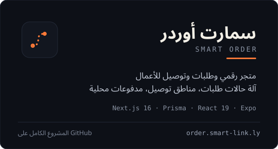

**«كلُّ عملٍ يبدأ رابطًا ويصبح منظومةً»**

أبني منظومات رقمية عربية-أولًا من ليبيا — تعليم وتجارة وأتمتة واستخبارات مفتوحة —
بشيفرة تصل إلى الإنتاج، وبوابات جودة آلية، واختبارات موثقة بالأرقام لا بالادعاء.

## الطرفية

نافذة حية رسمتُها يدويًا بـ SVG — والحركة فيها حقيقية لا صورة ثابتة:
الأسطر تُكتب واحدًا تلو الآخر عند فتح الصفحة، والمؤشر لا يتوقف عن الوميض،
ومؤشر `live` في شريط الحالة ينبض فعليًا طوال الوقت:

## من أنا

أنا **أحمد رضوان** — باني منتجات رقمية من ليبيا، أصمّم وأبرمج المنظومة كاملة:
من واجهة RTL أصيلة، إلى قاعدة البيانات، إلى تطبيق الجوال.

أؤمن أن **العربية-أولًا ليست ترجمة**: التجربة تُصمَّم من أول بكسل للاتجاه والخط
العربيين، وتُدفع بوسائل الدفع المحلية (ليبيانا / مدار)، وتُوثَّق بالعربية داخل
المستودع نفسه — من README ثنائي اللغة إلى سجل تغييرات لكل جولة تطوير.

## ما أعمل عليه

| المجال | المشاريع | ما يميّزه |
|---|---|---|
| **التعليم** | أُلارا · مدارك | نظام تشغيل جامعة متكامل ومنصة تعليم ذكي — مصفوفة إتقان لكل مفهوم، دورة بحوث علمية بقارئ PDF، حوكمة وسجل تدقيق |
| **التجارة** | سب نيشن · سمارت منيو · سمارت أوردر | سوق اشتراكات رقمية بمحفظة داخلية وتسليم مشفّر فوري، ومنصات SaaS للمطاعم والمتاجر بمدفوعات ليبية |
| **الأتمتة** | سمارت بوت · openwa | بوت ماسنجر متعدد المستأجرين بمدفوعات وموافقات تيليجرام، وبوابة واتساب بتشفير AES-256 وجلسات باقية بعد إعادة التشغيل |
| **الاستخبارات المفتوحة** | ليوسينت | بحث عبر أكثر من 40 منصة، خرائط معرفة تفاعلية، ملفات مدعومة بالأدلة ودرجات ثقة |

كل مشروع يحمل **عقدًا بصريًا مستقلًا موثقًا** — ألوانه ورموزه ونظام تصميمه — لكنها
تنتمي جميعًا إلى منظومة واحدة متكاملة.

## المكدّس التقني

لا شارات للزينة هنا — كل تقنية في هذه الورقة موجودة فعلًا في ملفات `package.json`
و`requirements.txt` للمشاريع المنشورة في هذه الصفحة:

## المشاريع المميزة

ثمانية منتجات مكتملة الجوانب — لكل منها هويته البصرية المستقلة الموثقة في
مستودعه. **انقر أي بطاقة لزيارة المستودع الكامل** — وتحت كل بطاقة ثلاث شارات
حية تُسحب من واجهة GitHub لحظة زيارتك: النجوم، والتفريعات، وآخر دفع:

<table>
  <tr>
    <td dir="ltr" width="50%" valign="top">
      
      
      
      
    </td>
    <td dir="ltr" width="50%" valign="top">
      
      
      
      
    </td>
  </tr>
  <tr>
    <td dir="ltr" width="50%" valign="top">
      
      
      
      
    </td>
    <td dir="ltr" width="50%" valign="top">
      
      
      
      
    </td>
  </tr>
  <tr>
    <td dir="ltr" width="50%" valign="top">
      
      
      
      
    </td>
    <td dir="ltr" width="50%" valign="top">
      
      
      
      
    </td>
  </tr>
  <tr>
    <td dir="ltr" width="50%" valign="top">
      
      
      
      
    </td>
    <td dir="ltr" width="50%" valign="top">
      
      
      
      
    </td>
  </tr>
</table>

## الإحصائيات والنشاط — بيانات حية

لا رقم في هذه الصفحة مكتوب يدويًا — كل ما يلي يُسحب من واجهة GitHub لحظة
زيارتك: نجوم، مساهمات، لغات، نشاط، كؤوس، وعدد الزوار. وحتى أفعى المساهمات
في الأسفل تُعاد بناء تلقائيًا كل ست ساعات عبر سير عمل آلي داخل هذا المستودع —
فبمجرد ظهور بيانات جديدة تظهر من نفسها، بلا تدخل يدوي:

 

 

 

 

<picture>
  <source media="(prefers-color-scheme: dark)" srcset="https://raw.githubusercontent.com/ahmadmedo1012/ahmadmedo1012/main/assets/snake-dark.svg">
  <source media="(prefers-color-scheme: light)" srcset="https://raw.githubusercontent.com/ahmadmedo1012/ahmadmedo1012/main/assets/snake-light.svg">
  
</picture>

 

كل ما في الأعلى حي: الإحصائيات والسلاسل والكؤوس واللغات والنشاط والزوار تُسحب لحظة فتحك الصفحة — والأفعى يعيد بناءها سير عمل آلي كل ٦ ساعات.

## تواصل

**واتساب هو القناة الأساسية** — أسرع طريق للرد مهما كان الموضوع، ويبقى البريد للمراسلات الرسمية:

<table>
  <tr>
    <td dir="rtl" width="28%" align="center">
      
       
      <a href="https://wa.me/218910089975"><b>واتساب</b></a>
       
      <b>+218 91 008 9975</b>
       
      القناة الأساسية — الأسرع ردًا
    </td>
    <td dir="rtl" width="24%" align="center">
      
       
      <a href="https://t.me/rhAhmed2011"><b>تليجرام</b></a>
       
      @rhAhmed2011
    </td>
    <td dir="rtl" width="24%" align="center">
      
       
      <a href="mailto:ahmadmedo1012@gmail.com"><b>البريد</b></a>
       
      ahmadmedo1012@gmail.com
    </td>
    <td dir="rtl" width="24%" align="center">
      
       
      <a href="https://github.com/ahmadmedo1012"><b>GitHub</b></a>
       
      @ahmadmedo1012
    </td>
  </tr>
</table>

ونماذج حية تعمل الآن: <a href="https://ulara.vercel.app"><b dir="ltr">ulara.vercel.app</b></a> · <a href="https://subnation.ly"><b dir="ltr">subnation.ly</b></a>

---

الواجهة والأصول البصرية في هذه الصفحة رسمت خصيصًا لهذا الحساب — SVG يدوي بلا تدرجات، وكل رقم فيها يُسحب حيًا من واجهة GitHub · دليل الهوية: <a href="IDENTITY.md">IDENTITY.md</a>

