


**«كلُّ عملٍ يبدأ رابطًا ويصبح منظومةً»**

أبني منظومات رقمية عربية-أولًا من ليبيا — تعليم وتجارة وأتمتة واستخبارات مفتوحة —
بشيفرة تصل إلى الإنتاج، وبوابات جودة آلية، واختبارات موثقة بالأرقام لا بالادعاء.

## الطرفية

نافذة حية رسمتُها يدويًا بـ SVG — والحركة فيها حقيقية لا صورة ثابتة:
الأسطر تُكتب واحدًا تلو الآخر عند فتح الصفحة، والمؤشر لا يتوقف عن الوميض،
ومؤشر `live` في شريط الحالة ينبض فعليًا طوال الوقت:


## من أنا

أنا **أحمد رضوان** — باني منتجات رقمية من ليبيا، أصمّم وأبرمج المنظومة كاملة:
من واجهة RTL أصيلة، إلى قاعدة البيانات، إلى تطبيق الجوال.

أؤمن أن **العربية-أولًا ليست ترجمة**: التجربة تُصمَّم من أول بكسل للاتجاه والخط
العربيين، وتُدفع بوسائل الدفع المحلية (ليبيانا / مدار)، وتُوثَّق بالعربية داخل
المستودع نفسه — من README ثنائي اللغة إلى سجل تغييرات لكل جولة تطوير.

## ما أعمل عليه — خط إنتاج حي

أربعة مسارات تعمل الآن، كل عقدة فيها تنبض والبيانات تتدفق بينها:


| المجال | المشاريع | ما يميّزه |
|---|---|---|
| **التعليم** | أُلارا · مدارك | نظام تشغيل جامعة متكامل ومنصة تعليم ذكي — مصفوفة إتقان لكل مفهوم، دورة بحوث علمية بقارئ PDF، حوكمة وسجل تدقيق |
| **التجارة** | سب نيشن · سمارت منيو · سمارت أوردر · سمارت لينك | سوق اشتراكات رقمية بمحفظة داخلية وتسليم مشفّر فوري، ومنصات SaaS للمطاعم والمتاجر بمدفوعات ليبية |
| **الأتمتة** | سمارت بوت · openwa | بوت ماسنجر متعدد المستأجرين بمدفوعات وموافقات تيليجرام، وبوابة واتساب بتشفير AES-256 وجلسات باقية بعد إعادة التشغيل |
| **الاستخبارات المفتوحة** | ليوسينت | بحث عبر أكثر من 40 منصة، خرائط معرفة تفاعلية، ملفات مدعومة بالأدلة ودرجات ثقة |

كل مشروع يحمل **عقدًا بصريًا مستقلًا موثقًا** — ألوانه ورموزه ونظام تصميمه — لكنها
تنتمي جميعًا إلى منظومة واحدة متكاملة.

## المكدّس التقني

عشرون أداة تتنفس بموجة كهرمانية — كلها موجودة فعلًا في ملفات `package.json`
و`requirements.txt` للمشاريع المنشورة في هذه الصفحة، لا شارات زينة:

## المشاريع المميزة

ثمانية منتجات مكتملة الجوانب — لكل منها هويته البصرية المستقلة الموثقة في
مستودعه، وكل بطاقة تلمع بنبض من لونها الخاص. **انقر أي بطاقة لزيارة المستودع
الكامل** — وتحت البطاقات لوحة مؤشرات حية متحركة تسحب النجوم والفروع
لحظة توليدها:

<table>
  <tr>
    <td dir="ltr" width="50%" valign="top">
      
    </td>
    <td dir="ltr" width="50%" valign="top">
      <a href="https://github.com/ahmadmedo1012/madarek">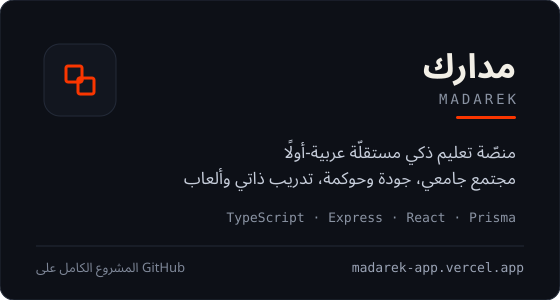</a>
    </td>
  </tr>
  <tr>
    <td dir="ltr" width="50%" valign="top">
      <a href="https://github.com/ahmadmedo1012/SubNation2">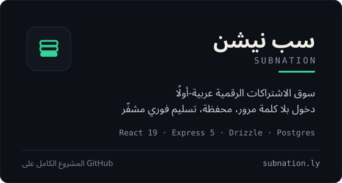</a>
    </td>
    <td dir="ltr" width="50%" valign="top">
      <a href="https://github.com/ahmadmedo1012/SmartBot">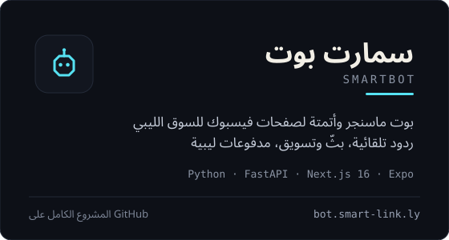</a>
    </td>
  </tr>
  <tr>
    <td dir="ltr" width="50%" valign="top">
      
    </td>
    <td dir="ltr" width="50%" valign="top">
      
    </td>
  </tr>
  <tr>
    <td dir="ltr" width="50%" valign="top">
      
    </td>
    <td dir="ltr" width="50%" valign="top">
      <a href="https://github.com/ahmadmedo1012/lyosint">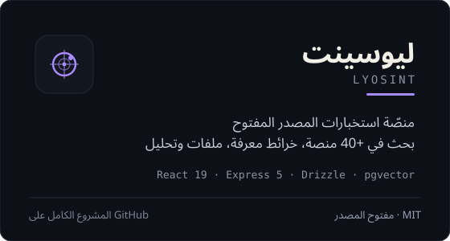</a>
    </td>
  </tr>
</table>


## القياسات الحيّة — محرك خاص لا صور جاهزة

لا رقم في هذه الصفحة مكتوب يدويًا، ولا مؤشر يستعيره من خدمة خارجية: **محرك
داخل هذا المستودع** (`scripts/generate-live-svg.mjs`) يسحب البيانات من واجهة
GitHub، ثم يرسمها SVG متحركًا بألوان الهوية — عدّادات تتدحرج لأرقامها، خريطة
مساهمات يمسحها شريط ضوئي، أشرطة لغات تنمو وتلمع — ويعيد كل ذلك تلقائيًا كل
ست ساعات عبر GitHub Actions:




<picture>
  <source media="(prefers-color-scheme: dark)" srcset="https://raw.githubusercontent.com/ahmadmedo1012/ahmadmedo1012/main/assets/snake-dark.svg">
  <source media="(prefers-color-scheme: light)" srcset="https://raw.githubusercontent.com/ahmadmedo1012/ahmadmedo1012/main/assets/snake-light.svg">
  
</picture>

 

كل ما في الأعلى حي ومتحرك: العدّادات تتدحرج، والخريطة تُمسح ضوئيًا، والأفعى تزحف — والمحرك يعيد بناءها كل ٦ ساعات بلا تدخل يدوي.

## تواصل

**واتساب هو القناة الأساسية** — أسرع طريق للرد مهما كان الموضوع، ويمكنك رؤية
قنواتي تنبض في اللوحة الحية أدناه:

<a href="https://wa.me/218910089975"></a>

<table>
  <tr>
    <td dir="rtl" width="28%" align="center">
      
       
      <a href="https://wa.me/218910089975"><b>واتساب</b></a>
       
      <b>+218 91 008 9975</b>
       
      القناة الأساسية — الأسرع ردًا
    </td>
    <td dir="rtl" width="24%" align="center">
      
       
      <a href="https://t.me/rhAhmed2011"><b>تليجرام</b></a>
       
      @rhAhmed2011
    </td>
    <td dir="rtl" width="24%" align="center">
      
       
      <a href="mailto:ahmadmedo1012@gmail.com"><b>البريد</b></a>
       
      ahmadmedo1012@gmail.com
    </td>
    <td dir="rtl" width="24%" align="center">
      
       
      <a href="https://github.com/ahmadmedo1012"><b>GitHub</b></a>
       
      @ahmadmedo1012
    </td>
  </tr>
</table>

ونماذج حية تعمل الآن: <a href="https://ulara.vercel.app"><b dir="ltr">ulara.vercel.app</b></a> · <a href="https://subnation.ly"><b dir="ltr">subnation.ly</b></a>

---

الواجهة والأصول البصرية في هذه الصفحة رسمت خصيصًا لهذا الحساب — SVG يدوي بلا تدرجات، كل رقم يُسحب حيًا من واجهة GitHub، وكل عنصر يتحرك بحركة مقصودة عبر SMIL · دليل الهوية: <a href="IDENTITY.md">IDENTITY.md</a>

