**أبني منتجات عربية بالكامل — من الواجهة إلى قاعدة البيانات.**

<table>
  <tr>
    <td dir="ltr" width="50%" valign="top">
      
    </td>
    <td dir="ltr" width="50%" valign="top">
      
    </td>
  </tr>
  <tr>
    <td dir="ltr" width="50%" valign="top">
      
    </td>
    <td dir="ltr" width="50%" valign="top">
      
    </td>
  </tr>
  <tr>
    <td dir="ltr" width="50%" valign="top">
      
    </td>
    <td dir="ltr" width="50%" valign="top">
      
    </td>
  </tr>
  <tr>
    <td dir="ltr" width="50%" valign="top">
      
    </td>
    <td dir="ltr" width="50%" valign="top">
      
    </td>
  </tr>
</table>

 

<table>
  <tr>
    <td dir="rtl" width="28%" align="center">
      
       
      <a href="https://wa.me/218910089975"><b>واتساب</b></a>
       
      <b>+218 91 008 9975</b>
       
      القناة الأساسية
    </td>
    <td dir="rtl" width="24%" align="center">
      
       
      <a href="https://t.me/rhAhmed2011"><b>تليجرام</b></a>
       
      @rhAhmed2011
    </td>
    <td dir="rtl" width="24%" align="center">
      
      
       
      <a href="mailto:ahmadmedo1012@gmail.com"><b>البريد</b></a>
       
      ahmadmedo1012@gmail.com
    </td>
    <td dir="rtl" width="24%" align="center">
      
       
      <a href="https://github.com/ahmadmedo1012"><b>GitHub</b></a>
       
      @ahmadmedo1012
    </td>
  </tr>
</table>

نماذج حية: <a href="https://ulara.vercel.app"><b dir="ltr">ulara.vercel.app</b></a> · <a href="https://subnation.ly"><b dir="ltr">subnation.ly</b></a>

---

دليل الهوية البصرية · <a href="IDENTITY.md">IDENTITY.md</a>

