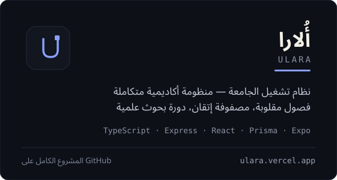
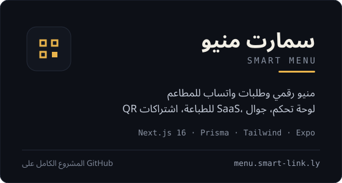
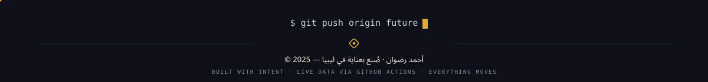

**«كلُّ عملٍ يبدأ رابطًا ويصبح منظومةً»**

أبني منظومات رقمية عربية-أولًا من ليبيا — تعليم وتجارة وأتمتة واستخبارات مفتوحة —
بشيفرة تصل إلى الإنتاج، وبوابات جودة آلية، واختبارات موثقة بالأرقام لا بالادعاء.

## من أنا

أنا **أحمد رضوان** — باني منتجات رقمية من ليبيا، أصمّم وأبرمج المنظومة كاملة:
من واجهة RTL أصيلة، إلى قاعدة البيانات، إلى تطبيق الجوال.

أؤمن أن **العربية-أولًا ليست ترجمة**: التجربة تُصمَّم من أول بكسل للاتجاه والخط
العربيين، وتُدفع بوسائل الدفع المحلية (ليبيانا / مدار)، وتُوثَّق بالعربية داخل
المستودع نفسه — من README ثنائي اللغة إلى سجل تغييرات لكل جولة تطوير.

## ما أعمل عليه

| المجال | المشاريع | ما يميّزه |
|---|---|---|
| **التعليم** | أُلارا · مدارك | نظام تشغيل جامعة متكامل ومنصة تعليم ذكي — مصفوفة إتقان لكل مفهوم، دورة بحوث علمية بقارئ PDF، حوكمة وسجل تدقيق |
| **التجارة** | سب نيشن · سمارت منيو · سمارت أوردر | سوق اشتراكات رقمية بمحفظة داخلية وتسليم مشفّر فوري، ومنصات SaaS للمطاعم والمتاجر بمدفوعات ليبية |
| **الأتمتة** | سمارت بوت · openwa | بوت ماسنجر متعدد المستأجرين بمدفوعات وموافقات تيليجرام، وبوابة واتساب بتشفير AES-256 وجلسات باقية بعد إعادة التشغيل |
| **الاستخبارات المفتوحة** | ليوسينت | بحث عبر أكثر من 40 منصة، خرائط معرفة تفاعلية، ملفات مدعومة بالأدلة ودرجات ثقة |

كل مشروع يحمل **عقدًا بصريًا مستقلًا موثقًا** — ألوانه ورموزه ونظام تصميمه — لكنها
تنتمي جميعًا إلى منظومة واحدة متكاملة.

## المكدّس التقني

لا شارات للزينة هنا — كل تقنية في هذه الورقة موجودة فعلًا في ملفات `package.json`
و`requirements.txt` للمشاريع المنشورة في هذه الصفحة:

## المشاريع المميزة

ثمانية منتجات مكتملة الجوانب — لكل منها هويته البصرية المستقلة الموثقة في
مستودعه. **انقر أي بطاقة لزيارة المستودع الكامل:**

<table>
  <tr>
    <td width="50%" valign="top"></td>
    <td width="50%" valign="top"></td>
  </tr>
  <tr>
    <td width="50%" valign="top"></td>
    <td width="50%" valign="top"></td>
  </tr>
  <tr>
    <td width="50%" valign="top"></td>
    <td width="50%" valign="top"></td>
  </tr>
  <tr>
    <td width="50%" valign="top"></td>
    <td width="50%" valign="top"></td>
  </tr>
</table>

## الإحصائيات والنشاط

أرقام حية تُسحب لحظة زيارتك — من GitHub مباشرة، بلا أي رقم مكتوب يدويًا:

 

 

## تواصل

أسرع ثلاث طرق للوصول إليّ — والبريد هو القناة المفضلة للأمور الجدية:

&nbsp;&nbsp;&nbsp;

&nbsp;&nbsp;&nbsp;

 

<a href="mailto:ahmadmedo1012@gmail.com"><b>ahmadmedo1012@gmail.com</b></a>

---

الواجهة والأصول البصرية في هذه الصفحة رسمت خصيصًا لهذا الحساب — SVG يدوي بلا تدرجات ولا شارات جاهزة · دليل الهوية: <a href="IDENTITY.md">IDENTITY.md</a>

